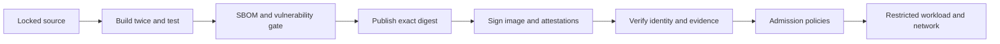

# hardened-container-supply-chain

[](https://github.com/jayekwere/hardened-container-supply-chain/actions/workflows/quality.yml)

A working container supply chain for a tiny Go HTTP service: build a scratch image, test its runtime restrictions, render and gate a Helm deployment, inventory and scan the exact image, then publish and verify a signed release by digest.

The application is intentionally small so the controls can be inspected end to end. It serves `GET /healthz`, `/readyz`, and `/version` on port 8080, needs no credentials, writes no application data, and makes no outbound requests.

## What this project demonstrates

| Control | Passing case | Deliberately failing case |
| --- | --- | --- |
| Hardened runtime | HTTP works as UID 65532 with a read-only root and no capabilities | Root, writable root and privilege changes fail integration checks |
| Reproducible build | Two uncached builds produce the same manifest digest | Archive identity, ownership and architecture mutations are rejected |
| Image scan | Fresh database and the exact image inventory pass policy | HIGH, CRITICAL, UNKNOWN and invalid exceptions block the gate |
| NetworkPolicy | Namespace-local ingress stays reachable | Cross-namespace ingress and workload HTTP/DNS egress time out; policy removal restores traffic |
| Admission | Exact signer, signed SBOM and signed evidence are accepted | Unsigned images, wrong identities, missing predicates and tampered attestations are rejected |
| Trust changes and faults | Restored trust and surviving control planes admit the valid image | Stale trust, missing policies, lost read permission and unavailable verifiers fail closed |

The verifier patch and its [183-probe trust-update experiment](docs/trust-updates.md) are the main implementation work: validation reads authoritative policy state before and after signature checks. The tests deliberately freeze or poison the older compiled copy. An unexpected admission fails immediately; a transport failure cannot count as a signature rejection. Earlier failed experiments remain in the evidence history.



## Results and release status

The [application v0.1.1 release](https://github.com/jayekwere/hardened-container-supply-chain/releases/tag/v0.1.1) passed hosted gates, anonymous signature verification and runtime tests against its published digest.

The October 30 scheduled-check review found a verifier outage-test race and newly reported dependency findings. The source now upgrades `go-jose/v4` to `v4.1.6` and `x/net` to `v0.62.0`. The rebuilt verifier passes the fresh scan locally and its independent recompilation is byte-identical. The strict scan policy and the single bounded OpenPGP VEX case are unchanged. See [the diagnosis, regression tests and dated results](docs/quality-maintenance.md). The replacement verifier is `controller-v0.1.2`; use it only after its release workflow passes and its release assets are published. The earlier `controller-v0.1.1` release predates these dependency fixes.

The [October 27 main run](https://github.com/jayekwere/hardened-container-supply-chain/actions/runs/40532668665) passed **341 admission observations**, including **183 trust-update probes with zero unexpected admissions**, and **80 network probes**. These are dated results, not a promise about future scans. [Failover evidence](docs/failover-recovery.md), [release evidence](docs/verifier-release.md) and [the verification record](docs/verification.md) retain the exact commands, counts and failure history.

The test environment uses disposable containerized nodes on one host. It does not establish independent-host availability or production readiness. Running Pods are not revalidated, policy writes are not atomic, and scans assess a dated package inventory. [Operational limits](docs/operations.md) explain those boundaries.

## Run the complete checks

Requirements: a Unix shell, Make, Python 3.12+, OpenSSL for disposable admission fixtures, a C compiler for Go's race detector, and a running OCI-compatible local engine with `docker buildx` and support for its container builder driver. The build script creates and removes a disposable BuildKit 0.30.0 builder pinned by image digest. Internet access is required for locked tool downloads, pinned images, public release verification and a vulnerability database updated within 24 hours. Linux amd64 and macOS arm64 tool installations are locked in `tools.lock.json`.

```sh
git clone https://github.com/jayekwere/hardened-container-supply-chain.git
cd hardened-container-supply-chain
make tools
make check
./scripts/sign-local.sh
make cluster
make admission
```

`make check` runs formatting and dependency checks, vet, race-enabled Go tests, chart lint and both policy examples, two uncached image builds, Go container integration tests, a fresh vulnerability scan, and CycloneDX SBOM generation. `make cluster` creates its own cluster and private kubeconfig, installs the real chart by digest, runs Go integration tests, and deletes that cluster. It never selects an existing cluster. It now uses two nodes and a digest-pinned policy agent alongside kindnet, and verifies 10 real traffic flows with policy absent, present, removed, and reapplied. Local and hosted runs each passed all 80 probes with zero mismatches. See [runtime network-policy evidence](docs/network-policy.md).

| Command | Result required |
| --- | --- |
| `make test` | Exact compiler, no external modules, vet and race tests pass |
| `make chart` | Hardened render passes; writable-root render exits 1 |
| `make reproduce` | Two uncached builds produce the same manifest digest |
| `make integration` | HTTP responds; UID/GID, read-only root, zero capabilities and no-new-privileges verified; shell absent |
| `make scan` | Versioned standard-library inventory, matching config digest, fresh database, no blocking findings |
| `./scripts/sign-local.sh` | Ephemeral-key SBOM signature verifies; changed bytes fail |
| `make cluster` | Service/runtime/admission checks pass; allowed ingress remains reachable; cross-namespace ingress and workload HTTP/DNS egress time out; removing the policy restores traffic |
| `make admission` | Build the patched verifier; exercise three API servers; require signatures and both predicates; reject stale trust and failed policy reads; test maintenance, verifier-node loss, elected-leader failover, quorum loss and restoration |

`make admission` separately provisions a disposable API-server verifier and runs passing/failing admission requests. It requires the exact release identity for the image signature and both attestations, with content checks for the SBOM and release evidence. See [attestation requirements, negative fixtures and exact results](docs/admission-attestations.md), plus the [signature and availability controls](docs/admission-signatures.md).

Individual commands reuse `artifacts/` from prior commands. Run `make tools` first, and build before running image-dependent checks. The local signature exercise deliberately disables transparency-log use; the release workflow requires identity certificates and normal transparency verification.

## Try passing and failing policies

```sh
# Generates the positive and negative renders and checks exact exit behavior:
make chart
cat artifacts/unsafe-policy.txt
# DENY K8S-READONLY

# Inspect the negative render directly; exit 1 is expected:
bin/policy manifests --file artifacts/unsafe.json.yaml
```

`examples/pass-values.yaml` uses an all-zero digest solely to render a fixture. It is not a deployable release. The policy accepts the chart's JSON-as-YAML documents and deliberately rejects arbitrary resource kinds, missing resources, mutable image references, root users, writable roots, privilege escalation, extra containers and mounts, token mounts, and altered network-policy selectors/rules. It is scoped to this chart, not a general Kubernetes admission engine.

The scanner fixtures in `internal/policy/testdata/scan-*.json` contain synthetic data. To observe the HIGH gate's failure without a live vulnerability:

```sh
bin/policy scan --file internal/policy/testdata/scan-high.json \
  --image-id sha256:1111111111111111111111111111111111111111111111111111111111111111 \
  --subject sha256:1111111111111111111111111111111111111111111111111111111111111111
# DENY HIGH:CVE-2099-0001|stdlib|v0.0.0-synthetic
# exit 1
```

Policy CLI exit codes: `0` pass, `1` denied, `2` invalid input or execution error. [Regression tests](internal/policy/scan_test.go) cover valid scoped exceptions, expiry, future dates, overlong lifetimes, digest/version mismatch, missing evidence, duplicate/unused entries, unknown severity and critical findings.

## Run the image

```sh
make image
docker run --rm --platform linux/amd64 --read-only --cap-drop ALL \
  --security-opt no-new-privileges --pids-limit 32 --memory 64m --cpus 0.5 \
  -p 127.0.0.1:8080:8080 supply-demo:local
# In a second terminal:
curl --fail http://127.0.0.1:8080/healthz
```

The image contains one statically linked executable, owned by UID/GID 65532; it contains no shell, package manager, OS packages, or certificate bundle. The archive gate checks the binary's ELF architecture against the image architecture. Read-only filesystem and privilege restrictions are runtime settings; the chart and integration commands set them explicitly.

## Verify and deploy a release

Release tags must have the form `vMAJOR.MINOR.PATCH` and point to a commit reachable from `main`. After the quality workflow passes, the release workflow rebuilds and rescans, publishes the exact manifest, signs it with the release workflow's short-lived identity, attaches signed SBOM and evidence predicates, and verifies all three before recording a release. No long-lived signing secret is configured.

Take the exact reference from the release's `image-reference.txt` asset. Do not substitute a mutable tag or the local image config digest.

Verifier claim checks compare signed source and patch hashes with the local checkout. Use the matching verifier tag's source when reproducing a historical release; verification against different dependency patches must fail.

```sh
export IMAGE='ghcr.io/jayekwere/hardened-container-supply-chain@sha256:e0b4773135955a2d269f5f241771ede7c4fb3a47d37896af175aae8f8e7efe22'
export TAG='v0.1.1'
./scripts/verify-release.sh "$IMAGE" "$TAG"

export KUBECONFIG='/absolute/path/to/your/kubeconfig'
git fetch origin --tags
export CONTROLLER_TAG='controller-v0.1.2'
mkdir -p artifacts/controller
curl --fail --location --proto '=https' \
  "https://github.com/jayekwere/hardened-container-supply-chain/releases/download/$CONTROLLER_TAG/image-reference.txt" \
  --output artifacts/controller/image-reference.txt
export CONTROLLER_IMAGE=$(cat artifacts/controller/image-reference.txt)
./scripts/verify-controller-release.sh "$CONTROLLER_IMAGE" "$CONTROLLER_TAG"
./scripts/install-admission.sh "$KUBECONFIG" "$CONTROLLER_IMAGE"
export PATH="$PWD/.tools/bin:$PATH"
DIGEST="${IMAGE##*@}"
helm template demo charts/supply-demo --set "image.digest=$DIGEST" > artifacts/deploy.json.yaml
bin/policy manifests --file artifacts/deploy.json.yaml
kubectl create namespace supply-demo
kubectl label namespace supply-demo pod-security.kubernetes.io/enforce=restricted \
  pod-security.kubernetes.io/enforce-version=v1.34 policy.sigstore.dev/include=true
helm install demo charts/supply-demo --namespace supply-demo --set "image.digest=$DIGEST" --wait
kubectl -n supply-demo port-forward service/demo 8080:8080
```

These deployment commands target your selected cluster and assume Kubernetes 1.34, Linux amd64 workload nodes for the published image, pull access to the image, and a network plugin that enforces NetworkPolicy. The chart supports Kubernetes 1.30+; the pinned integration environment tests 1.34. The network policy permits only namespace-local ingress to TCP 8080 and denies all pod egress, including DNS. The service needs neither DNS nor external connectivity.

The published verifier is Linux amd64. Native arm64 builds are exercised locally with `make admission`. For custom builds, use [these commands](docs/trust-updates.md#install-the-patched-verifier-explicitly); the installer requires its explicit image digest and cannot fall back to the old verifier.

The explicit installer enables API-server enforcement of the image signature and both SBOM/evidence attestations in the enrolled namespace; the application chart itself does not install cluster-wide verification infrastructure. The two admission policies pin the exact v0.1.1 workflow identity, check the released SBOM/evidence profile, and reject unmatched images. For a future release or rollback, review the exact signer identity and content profile in both policies, verify the selected digest, then run `helm upgrade` with that digest. Admission does not fetch the referenced scan reports or perform a new vulnerability scan.

## Evidence and design

- [Architecture and trust boundaries](docs/architecture.md)
- [Threat model](docs/threat-model.md)
- [Security decisions and dependency updates](docs/security-decisions.md)
- [Remediation and exception process](docs/remediation.md)
- [Release evidence format and permissions](docs/release-evidence.md)
- [Exact verification results and operational limits](docs/verification.md)

SBOMs, raw scans, database metadata, reproducibility output and test results are generated under ignored `artifacts/`. Hosted runs retain evidence for 14 days; tagged release runs retain it for 90 days and publish the final evidence as release assets. Scan evidence is a point-in-time package assessment, not a claim that the service has no vulnerabilities.

## License

MIT. See [LICENSE](LICENSE).
