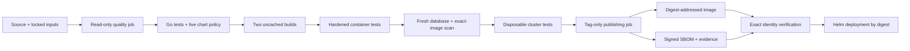

# Architecture

The runtime has one process and one port. There is no datastore, sidecar, shell, writable application volume, service-account credential, or application secret. Fixed HTTP responses keep the application useful for connectivity/probe testing without obscuring the supply chain.

The builder is an OCI image pinned by multi-platform index digest. Its platform-specific manifest is selected by BuildKit; the final image is Linux amd64 for publication. Local cluster tests compile for the engine's native architecture. The final stage starts from scratch and copies one executable. Package downloads and automatic toolchain downloads are disabled during compilation. The final image contains only linked runtime code, while the source and pipeline tools remain separate build inputs.

A release has two distinct digests: the image manifest digest selects the distributed artifact; the image config digest binds the scanner's metadata to the actual saved archive. `check-image.py` hashes the config bytes in that archive and checks the one-binary layout, ownership, entrypoint and ELF architecture. The scan gate compares that hash with scanner metadata. The release transfers the original OCI archive with `oras cp` to avoid engine-dependent recompression, then checks that the registry manifest matches the local build's manifest digest.

The chart emits JSON documents, which are valid YAML. This keeps the gate dependency-free and makes its limited input grammar explicit. Its four resources are a Deployment, ClusterIP Service, ServiceAccount, and NetworkPolicy. The rendered output is evaluated before deployment; the cluster separately applies restricted pod admission. The two-node integration environment also installs a digest-pinned NetworkPolicy agent beside kindnet. A test-only Go client enters the actual pod network namespace on its node, explicitly binds the pod IP, and probes literal pod/Service IPs and UDP DNS. No client or debug container is added to the application image or Deployment.

Trust boundaries are source review → build engine → scanner/database → registry → signature verifier → cluster kernel/network plugin. A correct signature establishes artifact integrity and expected signer identity. It does not independently establish source correctness, vulnerability absence, or uncompromised build infrastructure.
