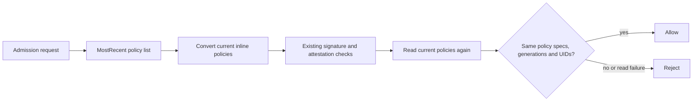

# Fail-closed trust-policy updates

The earlier verifier selected policies from a reconciled ConfigMap and a process-local watcher before consulting its verification cache. The recorded hosted run admitted five requests under the previous signer rule after a policy write. Cache keys already included policy UID and resource version; disabling that cache would not fix the older snapshot selected before the lookup. A draining verifier can also outlive a Service endpoint change.

The [downstream patch](../patches/policy-controller-freshness.patch) changes the shared workload-validation boundary. It preserves the existing signature and attestation implementation and adds authoritative policy reads around it. The source archive, compiler image, certificate base image and module checksums are locked. The image is built locally rather than presenting an unmodified upstream image as fixed.



Both reads use the API's MostRecent semantics: no resource version, selector or pagination limit is supplied. The validator never authorizes from `config-image-policies`. A changed UID, generation or spec invalidates a successful result, including creation, deletion or replacement of a policy. Status-only updates do not invalidate the check. Verification-result caches retain the current policy UID/resource-version key. Missing mandatory policies, deletion in progress, conversion errors and failed authoritative reads reject the request with `TRUST-FRESHNESS`.

The server's policy client is explicitly transferred into each HTTP admission context. The scale-down shortcut is restricted to unchanged objects apart from replicas and server-managed metadata/status; combining a replica reduction with a changed template, label or other configuration invokes normal validation. Pure scale-down remains available for cleanup after trust has tightened.

## Build and test

```sh
make tools
make test
make controller-image
make admission
```

The first controller build downloads the locked upstream module dependencies and needs more time/storage than the application build. The dedicated source tree and module/build caches stay under ignored `.tools/` and `.cache/`. `go test -mod=readonly`, `go mod verify` and a pinned compiler run in an isolated build container; the application module still has no external dependencies. `artifacts/controller/source.json` identifies the source, patch, binary, architecture and resulting image digest. The final image is non-root and contains the binary, certificate store and required license; the existing chart still supplies read-only-root, seccomp and capability restrictions.

`make admission` builds the verifier for the engine's native architecture, loads that image into a fresh three-control-plane cluster by digest and exercises each API server. The earlier 30-case signature/attestation matrix remains active. A stale `allowed` result in a negative case now fails immediately; it is never retried into a passing denial. The [verifier release guide](verifier-release.md) documents dependency remediation, release gates and the expanded multi-control-plane matrix; the 107-probe runs below remain historical single-API results.

Additional regressions freeze publication of the compiled policy ConfigMap, replace that copy with deliberately unsafe static-pass data, and change authoritative signer/attestation rules. Probes cover the API-server path and individually selected verifier Pods over CA-verified TLS connections, including a warmed process entering graceful termination. Other cases remove authoritative-list permission, delete/recreate the mandatory attestation policy, add a restrictive policy, and restore normal operation. Raw request results and policy-write acknowledgement times are retained in `artifacts/admission/trust-updates.json`. Test-only permission changes and unsafe data are confined to the disposable cluster and restored before cleanup.

Focused patched-source tests cover independent HTTP request contexts, poisoned watcher state, MostRecent request parameters, read failure, spec/UID changes during validation, status-only updates, unsupported references and scale-down variants. These do not claim that the entire upstream test suite was executed.

## Install the patched verifier explicitly

Build for the architecture of the target nodes, copy the generated image to a registry you control, and verify the copied manifest digest. Registry publication below is an operator command, not a claim that a new public controller image was published by this repository update:

```sh
CONTROLLER_ARCH=amd64 make controller-image
export CONTROLLER_REPOSITORY='registry.example.invalid/your-project/policy-controller'
CONTROLLER_DIGEST=$(python3 -c 'import json; print(json.load(open("artifacts/controller/build-metadata.json"))["containerimage.digest"])')
.tools/bin/oras cp --from-oci-layout "artifacts/controller/image.tar@$CONTROLLER_DIGEST" \
  "$CONTROLLER_REPOSITORY:trust-freshness"
test "$(.tools/bin/oras resolve "$CONTROLLER_REPOSITORY:trust-freshness")" = "$CONTROLLER_DIGEST"
export CONTROLLER_IMAGE="$CONTROLLER_REPOSITORY@$CONTROLLER_DIGEST"
./scripts/install-admission.sh /absolute/path/to/kubeconfig "$CONTROLLER_IMAGE"
```

Set a real registry repository and authenticate through the registry's normal credential mechanism before copying. No credential belongs in a manifest, source file or command-line argument. The installer now requires the explicit patched image digest. Its values file has an intentionally undeployable placeholder, preventing an accidental fallback to the old verifier.

An existing installation also needs its verifier image replaced; applying the policy JSON alone does not deploy this fix. Review the built image and use the same chart/security values with the explicit image override:

```sh
python3 scripts/fetch-admission-chart.py
.tools/bin/helm upgrade policy-controller .tools/charts/policy-controller-0.10.8.tgz \
  --kubeconfig /absolute/path/to/kubeconfig --namespace image-policy-system \
  --values integration/admission/controller-values.json \
  --set "webhook.image.repository=${CONTROLLER_IMAGE%@*}" \
  --set "webhook.image.version=${CONTROLLER_IMAGE##*@}" --wait --timeout 180s --no-hooks
python3 scripts/apply-bootstrap-policy.py /absolute/path/to/kubeconfig integration/admission/release-policy.json
python3 scripts/apply-bootstrap-policy.py /absolute/path/to/kubeconfig integration/admission/attestations-policy.json
```

Drain and retire **every** older unpatched verifier instance before relying on the new guarantee. `rollout status` alone does not prove that an older terminating process or established connection has ended. Perform the initial migration in an operator-controlled maintenance window and confirm process termination on every relevant node. The regression suite tests subsequent policy updates with the patched verifier; it does not claim that upgrading a live unpatched fleet is instantaneous.

## Scope and remaining limitations

- A request whose first validation read occurs after an acknowledged policy write uses that current policy state or is rejected. A policy change detected during verification also rejects the request. This is not a transaction with the API server's eventual object write: a request already approved before the final read/write boundary can finish afterward. Existing Pods are not evicted.
- Multiple policy writes are not an atomic bundle. Each request checks the actual complete policy set it reads. Plan updates so intermediate states are acceptable, or stop new workloads during a larger migration.
- This dedicated build requires `release-signer` and `release-attestations`, enforce mode and inline trust/policy material. Secret-backed trust keys/CAs, KMS, ConfigMap policy data, remote policies, custom TrustRoot and timestamp references are rejected rather than served from another cache. An unsupported policy anywhere in the controller's cluster-wide set blocks enrolled admissions, even if intended for a different image. Use the dedicated, image-bound policy profile in this repository; this is not a claim of compatibility with every upstream policy feature.
- Authoritative reads add API load and an availability dependency, with a five-second timeout per read. Failure rejects enrolled admissions even when a signature result is cached. No throughput or high-availability performance guarantee is claimed.
- Namespace enrollment, administrator access, the API's consistency contract, node/runtime integrity and distribution of the patched verifier remain trusted boundaries. Enrollment and webhook-routing changes are not made atomic by this patch. Outside-scope namespaces and supported cleanup/status operations retain their prior behavior. The original runs below used one API server; the expanded suite and its separate results are documented in the verifier release guide. No production performance guarantee is claimed.
- The application image and its evidence are independent of the separate verifier artifact. The verifier now has its own dependency patch, inventory, scan gate and release workflow; consult its release evidence rather than applying the application's scan results to it.

## Executed results

The final local run on 2026-10-25 (America/Vancouver) passed **107 trust-update probes with zero unexpected admissions**: **41 through the real API server** and **66 through CA-verified direct verifier connections**, covering three distinct Pods during a two-replica installation and replacement. Of these, 92 were required rejections and 15 were intentional admissions for valid requests, cleanup, scope and restoration controls.

| Local check | Exact outcome |
| --- | --- |
| Tightened signer identity with compiled publication frozen | 15 identity denials; zero admissions |
| Tightened attestation identity with compiled publication frozen | 15 identity denials; zero admissions |
| Warmed verifier entering graceful termination | All 5 post-write signer probes returned identity denial; no transport-failure substitute was needed |
| Deliberately static-pass compiled copy, unsigned image | 15 signature denials |
| Authoritative-list permission removed | 15 freshness denials; outside-scope unsigned control admitted |
| Mandatory attestation policy deleted | 15 freshness denials; recreated policy restored admission |
| Additional restrictive policy created | 15 explicit policy denials while publication remained frozen |
| Replica reduction | Unchanged template admitted; changed image and changed label each denied |
| Existing signature/attestation suite | 30 cases in 30 requests; zero stale admissions |
| Focused patched-source tests | 29 cases passed, including independent HTTP context and generation-change detection |
| Classification regressions | 21 passed |
| `make test`, workflow guards and actionlint | Exit 0 |
| Local OCI archive transfer | Copied manifest equals the built digest |

[Structured local evidence](evidence/trust-updates-local.json) records phase counts, exact policy-write acknowledgements, source and raw-output hashes, controller build identity, timestamps and normalized platform details. Raw output includes every individual probe. The disposable cluster and registry were removed; no fixture signing keys remain.

The [hosted run](https://github.com/jayekwere/hardened-container-supply-chain/actions/runs/40260523403) independently passed the same **107 probes, identical decision counts and zero unexpected admissions** on Linux amd64, including all five identity denials on the warmed draining verifier. It passed **29 focused verifier tests**, **21 classification regressions**, all existing quality gates and **80 network-policy probes with zero mismatches**. Its original 30-case suite used **31 requests**: the verifier-recovery control first rejected with webhook unavailable, then admitted on attempt 2. No negative trust-update case was retried into success. [Hosted structured evidence](evidence/trust-updates-hosted.json) preserves that recovery transition, every phase count, tested-source/raw-output hashes and artifact identity/digest. The [earlier five stale admissions](evidence/admission-attestations-hosted.json) remain unchanged historical evidence.

The hosted build archive digest was `sha256:d61ec58a974fa6d987e1c9234f9367ac466524e2231c1507d2f3e4fc869c1f4f`; the engine/import path reconstructed the manifest, and the live verifier used `docker.io/library/supply-policy-controller@sha256:345e9d2c5dd6cf665bae5eb868462275d49459c71a9e34ea33666f6dc54798da`. Both identities are recorded separately. The tests exercised the latter reference; there is no claim that these manifest digests match or that either was published to a registry. The local archive-copy check preserved its original native build digest; it is a separate transfer result.

Counts include only recorded probes. Administrative operations and requests generated asynchronously by cluster controllers are excluded. Direct verifier probes are real TLS HTTP requests to selected Pods, while the 41 API-server probes exercise the complete admission path; these are reported separately rather than combining them into a claim that all 107 traversed the API server.

References: [MostRecent API semantics](https://kubernetes.io/docs/reference/using-api/api-concepts/#semantics-for-get-and-list), [pinned verifier source](https://github.com/sigstore/policy-controller/tree/cc75baab1d34d3bae47bde7bd934bf79e5ca3afc).
